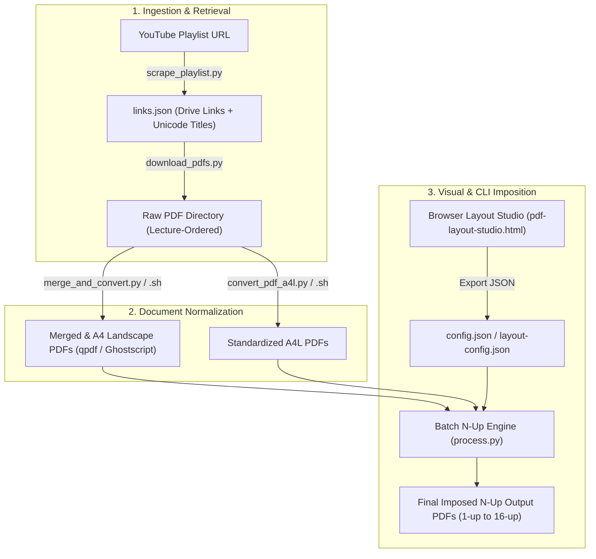

# PDF Layout Studio & Workflow Toolkit

<p align="center">
  
  
  
  
  
</p>

---

## 📌 Overview

**PDF Layout Studio** is an end-to-end automation suite and visual layout designer for PDF documents. It bridges the gap between browser-based interactive design and high-throughput command-line batch processing:

1. **Visual Imposition Studio**: An in-browser HTML5 canvas editor (`pdf-layout-studio.html` / `index.html`) to visually preview and fine-tune N-up multi-page grid layouts with real-time scaling, margins, gutters, borders, and color inversion.
2. **Deterministic CLI Engine**: A fast Python batch processor (`process.py`) powered by PyMuPDF (`fitz`) and NumPy that executes the exact mathematical layout generated in the browser with sub-pixel fidelity.
3. **Automated Scraping & Ingestion Pipeline**: Tools to extract Google Drive PDF resources from YouTube playlists (`scrape_playlist.py`), systematically download and validate them (`download_pdfs.py`), and normalize or merge multi-part documents into uniform A4 Landscape presentations (`merge_and_convert.py`, `convert_pdf_a4l.py`).

> **Core Design Principle:** *"Preview defines truth. Backend reproduces it exactly."*  
> Both browser and CLI calculation layers share identical coordinate geometry and aspect-ratio preservation algorithms.

---

## 🏗️ Architecture & Pipeline Flow



---

## 🗂️ Component Matrix

| Module | Entrypoint | Runtime / Engine | Core Responsibility |
|---|---|---|---|
| **Studio UI** | `pdf-layout-studio.html`, `index.html` | Browser (Canvas + PDF.js) | Visual drag-and-drop preview, margin/grid editor, and live JSON configuration exporter |
| **N-Up Imposer** | `process.py` | Python 3 + PyMuPDF + NumPy | High-performance N-up page imposition with grayscale/invert rasterization filters |
| **Playlist Scraper** | `scrape_playlist.py` | Python 3 + `yt-dlp` | Extracts Google Drive links from video descriptions and comments in strict playlist order |
| **Drive Downloader** | `download_pdfs.py` | Python 3 + `gdown` / `requests` | Serial download with rate-limit protection, validation checks, and Unicode sanitization |
| **Batch Merge/Convert** | `merge_and_convert.py`, `.sh` | Python 3 / Bash + `qpdf` + `gs` | Groups multi-part lecture PDFs, merges losslessly, and rescales to standard A4 Landscape |
| **Flat A4L Converter** | `convert_pdf_a4l.py`, `.sh` | Python 3 / Bash + Ghostscript | Recursively re-targets any PDF directory to uniform A4 Landscape geometry (842 × 595 pt) |
| **Terminal Progress** | `terminal_progress.py`, `setup_progress.py` | Pure Python (ANSI/ASCII) | Real-time honest progress bars, ETA tracking, and task status rendering across OSes |

---

## ⚡ Quick Start

### 1. Automated Setup

The repository provides automated setup scripts that verify prerequisites (Python 3.10+, Ghostscript, qpdf), initialize an isolated virtual environment (`.venv`), and install dependencies:

**Linux / macOS:**
```bash
chmod +x setup.sh
./setup.sh
source .venv/bin/activate
```

**Windows (PowerShell):**
```powershell
Set-ExecutionPolicy -Scope CurrentUser Bypass -Force
.\setup.ps1
.\.venv\Scripts\Activate.ps1
```

### 2. Instant In-Browser Preview

No local web server is needed. Double-click or open `pdf-layout-studio.html` in any modern web browser:
1. Drag and drop any PDF file onto the canvas.
2. Adjust rows, columns, margins, gaps, orientation, and color filters in the control panel.
3. Click **Export JSON** to save your layout as `config.json`.

### 3. CLI Imposition Execution

Run the Python processor using your saved configuration:

```bash
# Process a single document
python process.py config.json input.pdf output_nup.pdf

# Batch process an entire directory of PDFs
python process.py config.json ./input_folder/ ./output_folder/

# Inspect computed geometry and scaling parameters
python process.py config.json --info
```

---

## 📖 End-to-End Workflow Guide

### Step 1: Scrape Playlist for Google Drive Links
Extract all Google Drive resource URLs from lecture playlists while preserving sequential index and Unicode Bangla / multilingual title strings:

```bash
python scrape_playlist.py "https://www.youtube.com/playlist?list=YOUR_PLAYLIST_ID" -o links.json
# Resume interrupted runs without re-fetching:
python scrape_playlist.py "https://www.youtube.com/playlist?list=YOUR_PLAYLIST_ID" -o links.json --resume
```

### Step 2: Download & Validate Lecture PDFs
Download all extracted Drive documents sequentially with zero index drift, grapheme-aware filename truncation, and PDF magic-byte integrity validation:

```bash
# Download entire playlist series
python download_pdfs.py links.json -d ./lectures_raw

# Download specific index ranges
python download_pdfs.py links.json -d ./lectures_raw --from 1 --to 20
```

### Step 3: Batch Normalize & Merge (A4 Landscape)
Merge folders with multiple PDF attachments using `qpdf` (lossless) or Ghostscript fallback, standardizing to A4 Landscape (842 × 595 points):

```bash
# Using Python (Cross-platform with rich progress monitoring)
python merge_and_convert.py ./lectures_raw ./lectures_a4l

# Or using Bash
chmod +x merge_and_convert.sh
./merge_and_convert.sh ./lectures_raw
```

### Step 4: Batch N-Up Page Imposition
Combine multi-page slide decks into compact, print-ready 2-up, 4-up, 6-up, or custom grid layouts:

```bash
python process.py config.json ./lectures_a4l/ ./lectures_final_print/
```

---

## ⚙️ Configuration Reference

A sample `config.json` defining a 4-up grid on A4 Landscape paper:

```json
{
  "paper": "a4",
  "orientation": "landscape",
  "nup": 4,
  "layout": {
    "cols": 2,
    "rows": 2
  },
  "margin": 18,
  "gap": 6,
  "grayscale": false,
  "invert": false,
  "border": true,
  "quality": 2,
  "version": "1.0"
}
```

### Configuration Options

| Key | Supported Values | Description |
|---|---|---|
| `paper` | `a4`, `a3`, `a5`, `letter`, `legal`, `tabloid` | Standard sheet dimensions |
| `orientation` | `portrait`, `landscape` | Sheet orientation |
| `nup` | `1`, `2`, `4`, `6`, `8`, `9`, `12`, `16` | Standard N-up presets |
| `layout.cols`, `layout.rows` | Positive integers | Explicit grid configuration (overrides preset) |
| `margin` | Number (points, `1pt = 1/72"`) | Outer page boundary padding |
| `gap` | Number (points) | Gutter spacing between cells |
| `grayscale` | `true`, `false` | Convert colorspace to grayscale |
| `invert` | `true`, `false` | Invert colors (ideal for dark-background slides) |
| `border` | `true`, `false` | Draw thin demarcation outline around each cell |
| `quality` | `1`, `2`, `3`, `4` | Raster resolution factor (`quality * 72` DPI) |

### Paper Dimensions Reference

| Size Name | Portrait (pt) | Landscape (pt) | Dimensions (mm) |
|---|---|---|---|
| **A4** | 595 × 842 | 842 × 595 | 210 × 297 mm |
| **A3** | 842 × 1191 | 1191 × 842 | 297 × 420 mm |
| **A5** | 420 × 595 | 595 × 420 | 148 × 210 mm |
| **Letter** | 612 × 792 | 792 × 612 | 8.5 × 11.0 in |
| **Legal** | 612 × 1008 | 1008 × 612 | 8.5 × 14.0 in |
| **Tabloid** | 792 × 1224 | 1224 × 792 | 11.0 × 17.0 in |

---

## 📐 Layout Geometry & Math

The layout engine partitions available paper area while maintaining the source page aspect ratio without distortion:

```text
cell_width  = (paper_width  - (2 * margin) - ((cols - 1) * gap)) / cols
cell_height = (paper_height - (2 * margin) - ((rows - 1) * gap)) / rows

cell_x[c]   = margin + (c * (cell_width + gap))
cell_y[r]   = margin + (r * (cell_height + gap))

scale       = min(cell_width / src_width, cell_height / src_height)
scaled_w    = src_width * scale
scaled_h    = src_height * scale

offset_x    = (cell_width  - scaled_w) / 2
offset_y    = (cell_height - scaled_h) / 2
```

---

## 📊 Terminal Progress Engine

All CLI tools integrate with `terminal_progress.py` to provide consistent, honest terminal feedback:
- **Completed Counts**: Progress reflects actual successfully processed entities, never unverified operations.
- **Sub-task Progress**: Measurable PDF page loops update fractionally in real-time.
- **Headless & Redirected Safety**: Automatically detects interactive TTY vs piped output; switches to milestone logging when writing to log files.
- **ASCII Compatibility**: Reliable display on Windows PowerShell, Command Prompt, and Linux/macOS terminals without encoding crashes.

---

## 🔧 Prerequisites & Troubleshooting

| Dependency | Purpose | Ubuntu / Debian | macOS | Windows |
|---|---|---|---|---|
| **Python ≥ 3.10** | Core CLI runtime | `sudo apt install python3 python3-venv` | `brew install python` | [python.org](https://www.python.org/) |
| **Ghostscript (`gs`)** | PDF conversion & flattening | `sudo apt install ghostscript` | `brew install ghostscript` | [Ghostscript Downloads](https://www.ghostscript.com/) |
| **qpdf** (Recommended) | Lossless fast PDF merging | `sudo apt install qpdf` | `brew install qpdf` | `choco install qpdf` / [qpdf source](https://qpdf.sourceforge.io/) |

### Common Issues

- **Ghostscript not found**: Ensure `gs` (or `gswin64c` on Windows) is present in your system `PATH`. Test with `gs --version`.
- **qpdf warning**: If `qpdf` is absent, the merge scripts will automatically fall back to Ghostscript, which is fully functional.
- **ModuleNotFoundError**: Always ensure your virtual environment is active (`source .venv/bin/activate` or `.\.venv\Scripts\Activate.ps1`) before executing scripts.

---

## 📄 License

This project is licensed under the [MIT License](LICENSE).
